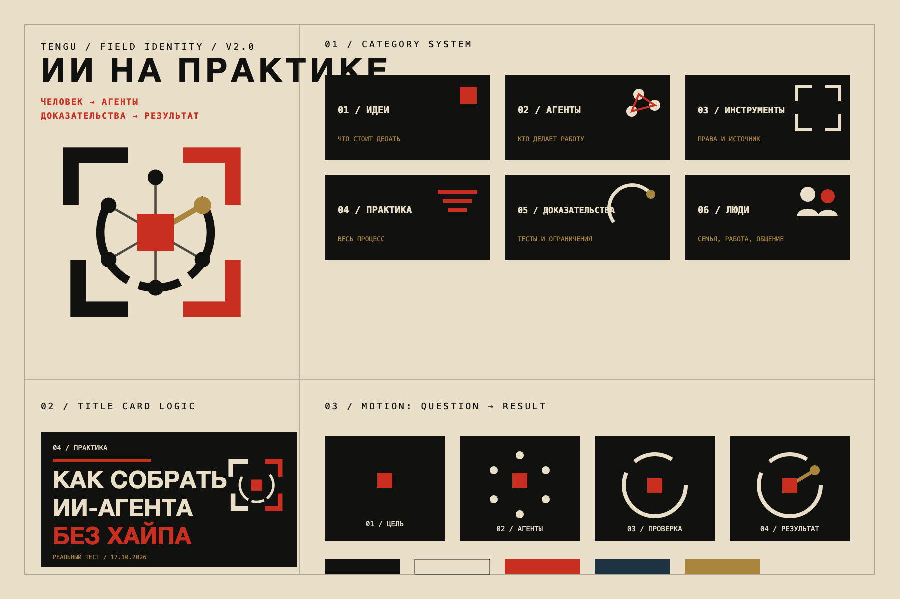

# TENGU — версия 2.0

Это не косметический редизайн первой версии. Здесь бренд построен как единая полевая система: цель → агенты → доказательства → проверенный результат.

## Основное решение

**Название канала:** TENGU — ИИ на практике  
**Подпись:** Проверено людьми.  
**Фраза бренда:** Люди ставят цель. Агенты делают работу. Мы показываем весь путь.

## Готовые файлы

| Задача | Файл |
|---|---|
| Полная логика бренда | `brand-guide.md` |
| Карта системы | `png/tengu-system-board.png` |
| Баннер YouTube | `png/tengu-youtube-banner.png` |
| Пример обложки | `png/tengu-thumbnail-example.png` |
| Аватар | `png/tengu-avatar-1024.png` |
| Прозрачный знак | `png/tengu-field-seal-1024.png` |
| Векторный знак | `assets/tengu-field-seal-color.svg` |
| Одноцветный знак | `assets/tengu-field-seal-mono.svg` |
| Горизонтальный логотип | `assets/tengu-wordmark.svg` |
| Фавикон | `png/favicon-32.png` |

## Дизайн-исследование

В `concepts/` сохранены четыре полноценные итерации:

1. `01-kinetic-mon.png` — отброшен: всё ещё слишком похож на красивый вихрь;
2. `02-proof-seal.png` — сильная печать, но слишком много псевдо-азиатского гранжа;
3. `03-field-manual.png` — выбранная основа: система сильнее отдельного логотипа;
4. `04-final-hybrid.png` — соединение полевого руководства и проверочного оттиска.

## Что принципиально изменилось

- убран шаблонный `Workshop`;
- исчез трёхлопастный знак;
- появилась содержательная топология из человека, агентов и доказательств;
- рубрики получили собственные маркеры;
- обложки строятся по повторяемой редакционной логике;
- интро рассказывает процесс, а не просто «красиво собирает логотип»;
- японская эстетика теперь живёт в дисциплине, пустоте и материале, а не в декоративном косплее.

