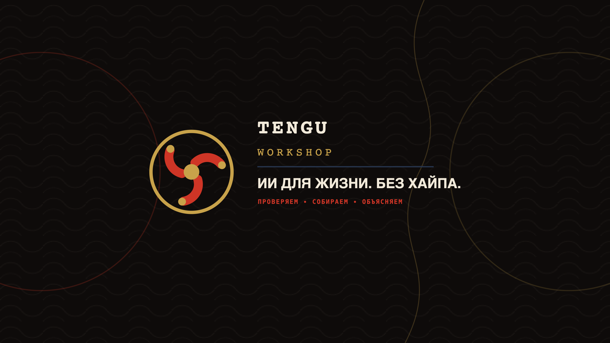

# Tengu Workshop brand kit

Готовая базовая система для канала **Tengu Workshop — ИИ без хайпа**.

## Что брать для запуска

| Задача | Файл |
|---|---|
| Аватар YouTube / TikTok | `png/tengu-workshop-avatar-1024.png` |
| Баннер YouTube | `png/tengu-workshop-youtube-banner.png` |
| Основа обложки ролика | `assets/tengu-workshop-thumbnail-template.svg` |
| Прозрачный знак | `png/tengu-workshop-mark-color-1024.png` |
| Векторный знак | `assets/tengu-workshop-mark-color.svg` |
| Одноцветный вектор | `assets/tengu-workshop-mark-mono.svg` |
| Горизонтальный логотип | `assets/tengu-workshop-wordmark.svg` |
| Фавикон | `png/favicon-32.png` |
| Референс интро | `png/tengu-workshop-intro-storyboard.png` |

Полные правила, позиционирование и готовые тексты: [brand-guide.md](brand-guide.md).

## Экспорт

SVG — мастер-файлы. Текст в вордмарке, баннере, шаблоне и раскадровке остаётся редактируемым. Перед финальным экспортом установить:

- [Shippori Mincho](https://fonts.google.com/specimen/Shippori+Mincho);
- [JetBrains Mono](https://www.jetbrains.com/lp/mono/);
- [Manrope](https://fonts.google.com/specimen/Manrope).

Для передачи в печать или сторонний монтаж перевести текст в кривые в Figma, Illustrator или Inkscape. Сам знак уже состоит только из векторных фигур и от шрифтов не зависит.

## PNG

- знак: 1024, 512, 256 px и favicon 32 px, прозрачный фон;
- аватар: 1024, 512, 256 px;
- баннер: 2560×1440 px;
- шаблон обложки: 1280×720 px;
- вордмарк: 1320×360 px;
- раскадровка: 1800×760 px.

## Статус

Это полноценная версия 1.0 для запуска канала. Перед регистрацией товарного знака и покупкой домена нужна отдельная юридическая проверка названия.

