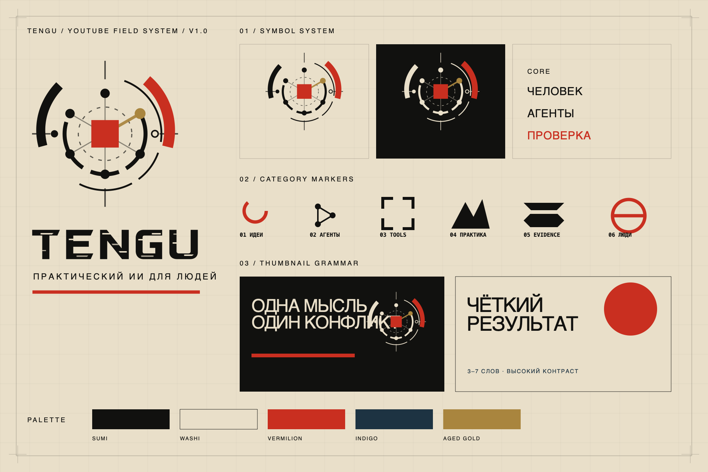

# TENGU — YouTube brand system

Русская точка входа для продолжения проекта: [START-HERE-RU.md](START-HERE-RU.md).  
Полный русский гайдлайн: [GUIDELINES-RU.md](GUIDELINES-RU.md).  
Состав выдачи: [DELIVERY-MANIFEST.md](DELIVERY-MANIFEST.md).

Production-ready identity based on the selected **Field Manual** direction: washi paper, sumi ink, vermilion signal, technical registration marks, agent orbits, and an evidence-first editorial tone.



## Brand name

- Display name: **TENGU — практический ИИ**
- Core descriptor: **ПРАКТИЧЕСКИЙ ИИ ДЛЯ ЛЮДЕЙ**
- English secondary descriptor: **PRACTICAL AI FOR REAL PEOPLE**
- Brand promise: **Человек задаёт цель. Агенты работают. Результат проверяется.**

`TENGU` is the stable master brand. The Russian descriptor explains the channel in search, headers, and first-contact surfaces; it does not replace the name.

## Start here

- [Full brand guide](brand-guide.md)
- [Primary vector logo](source/svg/tengu-mark-primary.svg)
- [Custom technical wordmark](source/svg/tengu-wordmark-custom.svg)
- [Hero ink wordmark](source/svg/tengu-wordmark-hero.svg)
- [Wordmark comparison sheet](exports/png/wordmark-study-1600x1000.png)
- [YouTube banner](exports/png/youtube-banner-2560x1440.png)
- [Channel avatar](exports/png/tengu-avatar-1024.png)
- [Light thumbnail template](source/templates/thumbnail-light.svg)
- [Dark thumbnail template](source/templates/thumbnail-dark.svg)
- [Logo sting MP4](motion/remotion/out/tengu-logo-sting.mp4)
- [Logo sting with alpha](motion/remotion/out/tengu-logo-sting-alpha.mov)
- [Isolated symbol motion MP4](motion/remotion/out/tengu-symbol-motion.mp4)
- [Isolated symbol motion with alpha](motion/remotion/out/tengu-symbol-motion-alpha.mov)
- [Light chapter bumper](motion/remotion/out/tengu-chapter-bumper-light.mp4)
- [Dark chapter bumper](motion/remotion/out/tengu-chapter-bumper-dark.mp4)
- [Ready-to-paste AI agent prompt](handoff/ai-agent-prompt.md)
- [Channel name, About copy, playlists, and recurring formats](handoff/channel-launch-copy.md)
- [Russian technical handoff for a designer](handoff/TECHNICAL-HANDOFF-RU.md)

## Folder map

```text
source/svg/          editable logo system and category icons
source/templates/    editable YouTube layout templates
exports/png/         ready-to-upload and ready-to-place raster files
textures/            generated light/dark 1080p and 4K atmosphere plates
motion/remotion/     editable, deterministic motion project
handoff/             briefs, prompts, checklist, production notes
fonts/               installable TTF, web WOFF2, and OFL licenses
references/          approved reference and original concept board
deliverables/        handoff-ready files grouped by use
scripts/             deterministic asset and audio builders
```

## Ready exports

| File | Use |
|---|---|
| `youtube-banner-2560x1440.png` | Channel banner; artwork respects the 1546×423 all-device safe zone |
| `tengu-avatar-1024.png` | Main channel avatar |
| `tengu-watermark-150.png` | YouTube video watermark |
| `thumbnail-light-1280x720.png` | Ideas, tools, explainers |
| `thumbnail-dark-1280x720.png` | Evidence, failures, security, verdicts |
| `lower-third-1920x1080.png` | Transparent presenter ID overlay |
| `end-screen-1920x1080.png` | Two-video end screen and subscribe target |
| `tengu-logo-sting.mp4` | 2.4 s finished bumper with audio |
| `tengu-logo-sting-alpha.mov` | 2.4 s ProRes 4444 overlay with alpha and audio |
| `tengu-symbol-motion.mp4` | 2.4 s isolated animated symbol without wordmark |
| `tengu-symbol-motion-alpha.mov` | isolated symbol as ProRes 4444 with alpha |
| `tengu-chapter-bumper-*.mp4` | 3 s editable chapter separators |

## Rebuild

```bash
/usr/local/bin/python3 scripts/build_assets.py
/usr/local/bin/python3 scripts/build_audio.py
cd motion/remotion
npm install
npm run render:sting
npm run render:alpha
npm run render:symbol
npm run render:symbol-alpha
npm run render:chapter-light
npm run render:chapter-dark
```

Open the motion editor with `npm run studio`. Chapter text and theme live in `motion/remotion/src/Root.tsx`.

## Important production rule

Do not ask a text-to-video model to redraw the logo. It will drift between frames and change node counts, geometry, and lettering. Animate the supplied SVG/Remotion system deterministically. Use generative video only for optional paper, ink, mountain, smoke, or light texture plates behind the identity.

